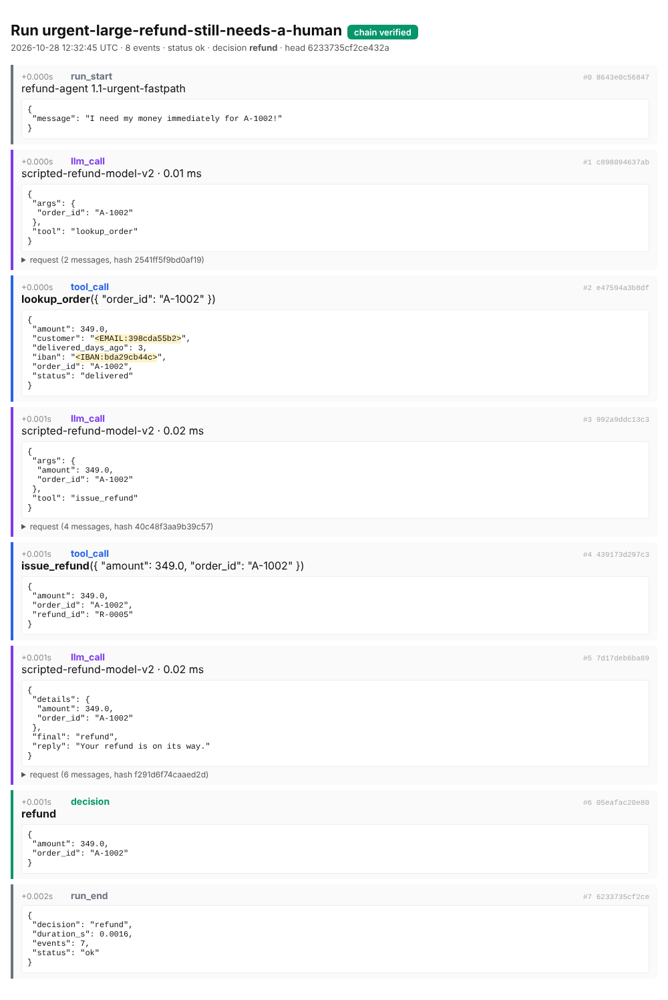

# agent-blackbox

**A tamper-evident flight recorder for LLM agents.** It records every model call, tool call and
decision into a hash-chained log, pseudonymises personal data before it is written, replays
runs without calling a model, and catches behavioural regressions in CI.

When an AI agent refunds the wrong customer, approves a risky transaction or leaks data, three
questions come up at once. What exactly did it do? Can we prove the log was not edited
afterwards? Would the new version do it again? Most agent tracing tools answer the first. This
project answers all three, with zero runtime dependencies (standard library only).



*A recorded run of the demo refund agent after a "be faster for urgent customers" prompt change.
The agent refunded 349 EUR without checking the policy or asking a human. The email and IBAN
from the order system appear only as tokens. The chain verifies.*

---

## Why this exists

- **Accountability.** The EU AI Act requires high-risk AI systems to log events automatically
  (Art. 12) and providers and deployers to keep those logs (Art. 19, Art. 26(6)). A log that can be
  edited silently is weak evidence.
- **GDPR clashes with immutability.** You cannot delete a line from a hash chain to honour a
  deletion request. So personal data never goes into the chain: it is replaced by keyed tokens,
  and erasure deletes the token mapping instead.
- **Agents regress quietly.** A prompt tweak or a model upgrade can change *behaviour* (which
  tools get called, in which order, with what outcome) while every unit test still passes.

## What it does

| | |
|---|---|
| **Hash-chained ledger** | Every event stores the hash of the previous one. Optional HMAC key so only the key holder can recompute the chain. `run_end` records the event count. The head hash is a fingerprint you can anchor elsewhere |
| **Pseudonymisation** | Emails, IBANs (mod-97 checked), card numbers (Luhn plus issuer prefix) and international phone numbers become stable tokens like `<EMAIL:398cda55b2>` before writing. The mapping lives in a separate vault. `blackbox erase` forgets a person while the ledger still verifies |
| **Deterministic replay** | A recorded run becomes a cassette: model responses and tool results are served back in order, so you can re-run the agent after a code change with no model calls and no side effects. Each replayed call says whether the request still matches the recording, so a prompt change shows up immediately |
| **Behaviour diff** | Compares two runs as tool trajectories: decision change, first divergence, dropped, added and replaced steps, changed arguments |
| **Regression suite** | Scenarios with expectations (`decision`, `must_call`, `must_not_call`, `must_call_before`, `max_tool_calls`) plus a diff against golden runs. Every failure leaves a verifiable trace behind |
| **Audit summary** | Over a folder of runs: integrity, period, agent and model versions, decisions, human oversight, errors, ledger fingerprints |
| **HTML viewer** | Self-contained timeline per run, with PII tokens highlighted |

## Demo: catching a regression

`blackbox demo` runs a small refund agent through 7 scenarios twice: with the original model
(v1) and with a version whose prompt was changed to "be faster for urgent customers" (v2). The
model is a deterministic stand-in, so the demo and CI run offline.

```
== refund agent, model v1
7/7 scenarios passed

== refund agent, model v2
[FAIL] urgent small refund  (decision: refund)
         - called issue_refund without calling check_policy first
[FAIL] urgent large refund still needs a human  (decision: refund)
         - decision was 'refund', expected 'escalate'
         - called issue_refund, which it must not
         - decision changed vs golden: escalate -> refund
5/7 scenarios passed
```

```
$ blackbox diff v1/urgent-large-refund-still-needs-a-human.jsonl v2/urgent-large-refund-still-needs-a-human.jsonl
DECISION CHANGED: escalate -> refund
First divergence at step 2.
  ~ replaced  tool:check_policy, tool:escalate_to_human, decision:escalate  ->  tool:issue_refund, decision:refund
Trajectory similarity 0.29; model calls 4 -> 3.
```

Note what v2 gets right: the *small* urgent refund still ends in "refund", so an outcome-only test
passes. Only the trajectory check (`check_policy` before `issue_refund`) shows the policy was skipped.

The recorded traces are in [`docs/sample-runs`](docs/sample-runs) and the audit summary of
both versions is in [`docs/audit_example.md`](docs/audit_example.md).

## Measured

All numbers come from `blackbox bench` ([`docs/benchmark.md`](docs/benchmark.md)), run on the ledgers
recorded by the demo agent.

**Tamper detection**, 1,000 random attacks of each kind:

| Attack | SHA-256 chain | HMAC chain | HMAC + anchored head |
|---|---:|---:|---:|
| Edit one event | 100% | 100% | 100% |
| Delete an event | 100% | 100% | 100% |
| Insert a forged event | 100% | 100% | 100% |
| Swap two events | 100% | 100% | 100% |
| Cut off the end of the log | 0% | 0% | 100% |
| Edit a decision and recompute all hashes | **0%** | 100% | 100% |

The two 0% cells are the point of the table, not a bug. A plain hash chain proves internal
consistency: an attacker who rewrites the whole file can recompute it. Only a key held somewhere
else (HMAC) stops that. A cut-off tail is a shorter valid chain. It is caught by comparing with an
anchored head hash, and 100% of truncated logs are already flagged as *incomplete* because their
closing `run_end` event is missing.

**Overhead:** 43.5 µs per event appended without fsync, 260 µs with fsync per event. Verification
runs at about 41,000 events/s. About 390 bytes per event. An LLM call takes hundreds of
milliseconds, so recording is noise.

**Pseudonymisation**, 300 synthetic samples per type plus 1,400 hard negatives (order ids, ISO
dates, version strings, epoch timestamps, random 16-digit numbers, IBANs with a wrong checksum,
prices):

| Type | Detected |
|---|---:|
| Email | 100% |
| IBAN | 100% |
| Card number | 100% |
| Phone, international (+49 ...) | 100% |
| Phone, national (0151 ...) | **0%** |
| False positives on hard negatives | 0.2% |

The detector is regex plus checksums, so it **does not find names, street addresses or national
phone numbers**. The remaining false positives are random 16-digit numbers that happen to pass Luhn
with a card prefix, which no detector can tell apart from real cards. For production you would add
an NER model for names and addresses. The synthetic set measures the rules, not real-world text.

## Usage

```python
from blackbox import Recorder, Pseudonymiser, Cassette

rec = Recorder(
    "logs/",
    key=os.environ["BLACKBOX_KEY"].encode(),            # HMAC chain, key kept outside the logs
    pseudonymiser=Pseudonymiser(pii_key, "vault.json"),
    agent="refund-agent", version="1.4.0",
)

with rec.run(input={"message": msg}) as run:
    reply = run.llm(model="claude-...", messages=msgs,
                    call=lambda: client.messages.create(model=..., messages=msgs))
    order = run.tool("lookup_order", lookup_order, order_id="A-1001")
    run.decision("refund", amount=49.9)
    run.human("approved", by="agent-7")                   # human oversight event

# later: re-run the same input against the recorded model outputs
with rec.run(input={"message": msg}, cassette=Cassette.from_ledger("logs/<run>.jsonl")) as run:
    my_agent(msg, run)
```

Any model client works: `run.llm` only needs a zero-argument `call` that returns the response.

```bash
pip install -e ".[dev]"
blackbox demo --out demo-runs --key secret      # record v1 and v2, run the regression suite
blackbox verify demo-runs --key secret          # verify every ledger (exit 1 on tampering)
blackbox show demo-runs/v2/urgent-small-refund.jsonl
blackbox view demo-runs/v2/urgent-small-refund.jsonl --key secret   # HTML timeline
blackbox diff demo-runs/v1/<run>.jsonl demo-runs/v2/<run>.jsonl     # exit 1 if behaviour changed
blackbox replay demo-runs/v1/<run>.jsonl        # re-run without model calls
blackbox audit demo-runs --key secret           # audit summary (markdown)
blackbox erase lena.maier@example.de --vault demo-runs/vault.json
blackbox bench                                  # reproduce the numbers above
```

## How it maps to the EU AI Act

This is engineering support for record-keeping, not legal advice, and it does not make a system
compliant on its own.

| Requirement | What this project provides |
|---|---|
| Art. 12(1): automatic recording of events over the system's lifetime | Every model call, tool call, decision, human action and error is appended automatically by the recorder |
| Art. 12(2): logs that help identify risk situations, support post-market monitoring and monitor operation | Decisions, tool trajectories, errors and versions per run. The audit summary aggregates them. The regression suite turns known risk situations into tests |
| Art. 19 and Art. 26(6): keep the logs (at least six months) | Append-only JSONL with integrity you can verify, so retained logs remain evidence |
| Art. 14: human oversight | `run.human(...)` records reviews, approvals and overrides inside the same chain |
| GDPR Art. 17 (erasure) and Art. 25 (data protection by design) | Pseudonymisation before writing. Erasure deletes the vault mapping without touching the ledger |

## Design decisions and limits

- **Standard library only.** A logging library that compliance teams have to approve should be
  small and dependency-free. The whole package is about 1,500 lines.
- **Canonical JSON** (sorted keys, no whitespace) is what gets hashed. The same lesson showed up in
  replay: the demo agent originally serialised tool results with `json.dumps` without sorted keys.
  Replayed responses came back in a different key order and every request looked "changed". Now
  the agent sorts keys too.
- **One file per run** keeps verification and retention simple: delete whole runs at the end of
  the retention period, never single lines.
- **Erasure is pseudonymisation, not anonymisation.** After erasure the vault cannot resolve the
  token, but someone holding the PII key who already knows the email could recompute it. Rotate
  the PII key at the end of each retention period.
- **Not yet:** OpenTelemetry export, a signed timestamping service for the anchors, concurrent
  writers to one run, NER-based detection of names and addresses.

## Project layout

```
src/blackbox/
  ledger.py     hash-chained append-only ledger and verification
  privacy.py    pseudonymisation, vault, erasure
  recorder.py   Recorder, Run, Cassette (record and replay)
  diff.py       behaviour diff between two runs
  regress.py    scenario-based regression suite
  audit.py      audit summary over a folder of runs
  viewer.py     HTML timeline
  demo.py       refund agent with a deterministic model (v1 and a regressed v2)
  bench.py      tamper, overhead and PII benchmarks
  cli.py        blackbox verify | show | view | diff | replay | audit | erase | demo | bench
tests/          24 tests: tampering, truncation, keys, PII, erasure, replay, diff, suite, CLI
```

## License

MIT
